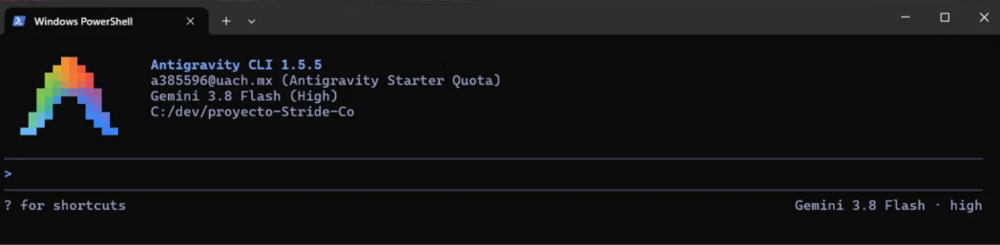

# Pruebas E2E generadas con Antigravity

Este documento registra cómo se generó, revisó y corrigió el código de las pruebas E2E de la autenticación y de `GET /health`. Antigravity solo escribió el código: el resultado son archivos normales de Jest + Supertest en `test/e2e/`, que se ejecutan con `npm run test:e2e` sin depender de Antigravity.

## 1. Sesión de Antigravity

- Herramienta: Antigravity CLI 1.5.5, ejecutada desde la terminal con el comando `agy` dentro del repositorio.
- Cuenta: institucional de la UACH (visible en la captura).
- Modelo: Gemini 3.8 Flash.



## 2. Prompts utilizados (en orden)

### Prompt 1: `health.e2e.test.js`

```
Lee app.js, routes/index.js, test/e2e/helpers.js y test/e2e/baseUrl.js. Escribe test/e2e/health.e2e.test.js con Jest + Supertest, sin mocks, que compruebe que GET /health responde 200 con {"status":"UP"}. Usa getBaseUrl() de test/e2e/baseUrl.js.
```

### Prompt 2: `auth.e2e.test.js`

```
Lee routes/auth.js, controllers/auth.js, middlewares/authenticate.js, test/e2e/helpers.js y la sección Autenticación del README. Escribe test/e2e/auth.e2e.test.js con Jest + Supertest, sin mocks: login correcto devuelve un JWT; credenciales incorrectas responden 401; datos incompletos responden 400; usuario inactivo responde 401; GET /api/products sin token y con token inválido responde 401; GET /api/auth/me con token válido responde 200 y no incluye password_hash ni salt_key. Usa login(rol) y createCleanup() de helpers.js y las contraseñas de seed.demoPasswords. Cada prueba debe limpiar lo que crea. Compara solo códigos de estado, no textos de mensajes.
```

Durante la sesión, el agente pidió permiso para ejecutar comandos de lectura (por ejemplo, `dir test\e2e`). Se aprobó cada uno por separado, sin guardar permisos permanentes, y no se aprobó ningún comando que hiciera commit, borrara archivos o instalara dependencias.

## 3. Qué generó el agente y qué corrigió el equipo

### `test/e2e/health.e2e.test.js`

Se aceptó sin cambios después de revisarlo: comprueba el código 200 y el body completo con `toEqual({ status: 'UP' })`, usa `api()` de `helpers.js` (que lee la URL de `getBaseUrl()`) y no usa mocks.

### `test/e2e/auth.e2e.test.js`

El agente generó 6 pruebas. Todas usaban `helpers.js`, comparaban solo códigos de estado y no tenían mocks. El equipo hizo estas correcciones:

| # | Corrección | Por qué |
|---|---|---|
| 1 | `role_id: 3` fijo en la creación del usuario inactivo, reemplazado por una búsqueda del rol `user` por nombre en `GET /api/roles` | El id de un rol depende del orden de siembra. Podría cambiar al recrear la base de datos o en Render, y la prueba crearía el usuario con otro rol o fallaría |
| 2 | Se agregó `expect(createRes.body.data.active).toBe(false)` al crear el usuario inactivo | Para que, si la API ignorara `active: false`, el fallo apunte a la causa real y no solo al login |
| 3 | En `GET /api/auth/me` con token válido se agregó `expect(response.body.email).toBe(DEMO_USERS.admin)` y se quitaron las dos aserciones `toBeUndefined` redundantes | Las aserciones originales solo comprobaban ausencias: un 200 con body vacío habría pasado la prueba |
| 4 | Se agregó la prueba `GET /api/auth/me sin token responde 401` | El issue pide 401 en rutas protegidas, y `/api/auth/me` es una ruta protegida distinta de `/api/products` que el agente no cubrió |

Resultado después de las correcciones: 2 suites, 8 pruebas.

## 4. Token expirado

El criterio del issue menciona "inválido o expirado". En E2E solo se prueba el token inválido. Un token expirado habría que firmarlo con `jwt.secret`, que coincide únicamente con la API local: contra Render el secreto es otro, la respuesta sería 401 por firma inválida y la prueba pasaría por un motivo distinto al que dice comprobar. Por eso no se incluyó.


## 5. Roturas a propósito

Antes de aceptar cada prueba generada se cambió a propósito un valor esperado y se comprobó que la prueba fallaba. Después se restauró.

| Prueba | Cambio | ¿Falló? |
|---|---|---|
| Login correcto | `toHaveLength(3)` por `toHaveLength(2)` | <sí> |
| Credenciales incorrectas | `401` por `200` | <sí> |
| Datos incompletos | `400` por `401` | <sí> |
| Usuario inactivo | `active: false` por `active: true` | <sí> |
| Rutas protegidas | `401` por `200` | <sí> |
| `/api/auth/me` con token | `not.toHaveProperty('salt_key')` por `toHaveProperty('salt_key')` | <sí> |
| `/api/auth/me` sin token | `401` por `200` | <sí> |
| Health | `'UP'` por `'DOWN'` | <sí> |


## 6. Limpieza de datos

La prueba del usuario inactivo crea un usuario `inactivo-<timestamp>@stride.co` y lo registra con `createCleanup()`, que lo elimina al terminar cada prueba. Se ejecutó la suite dos veces seguidas y la tabla `users` quedó solo con los tres usuarios de demostración (`admin`, `sales` y `user`).

## 7. Cómo ejecutarlas

```bash
npm run seed       # roles, permisos y usuarios de demostración
npm start          # API en http://localhost:3000
npm run test:e2e   # en otra terminal
```

Contra el despliegue en Render:

```bash
E2E_BASE_URL=https://<servicio>.onrender.com npm run test:e2e
```

## 8. Resultado

```
Test Suites: 2 passed, 2 total
Tests:       8 passed, 8 total
```