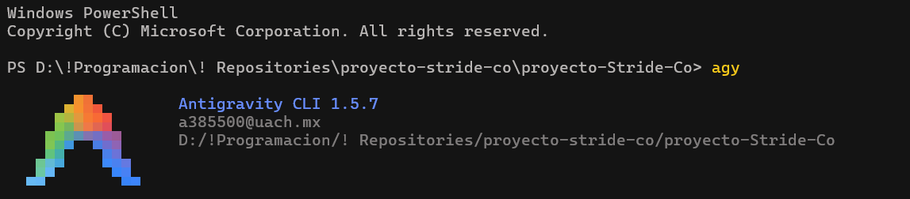

# Pruebas E2E generadas con Antigravity

Este documento registra cómo se generó, revisó y corrigió el código de las pruebas E2E de `test/e2e/`. Antigravity solo escribió código: el resultado son archivos normales de Jest + Supertest que se ejecutan con `npm run test:e2e`, sin depender de Antigravity ni de ninguna otra herramienta.

| Suite | Cómo se escribió | Sesión |
|---|---|---|
| `health`, `auth` | Antigravity, revisada y corregida por el equipo | Dannonini |
| `users`, `roles`, `permissions` | Antigravity, revisada y corregida por el equipo | LF-Dguez |
| `products`, `variants` | Antigravity, revisada y corregida por el equipo | LF-Dguez |
| `inventory`, `customers`, `orders`, `rbac`, `i18n` | Antigravity, revisada y corregida por el equipo | LF-Dguez |

## 1. Sesiones de Antigravity

Ambas sesiones usaron Antigravity CLI, ejecutado desde la terminal con el comando `agy` dentro del repositorio, con cuentas institucionales de la UACH (visibles en las capturas).

**Sesión 1 (Dannonini):** `health` y `auth`. Antigravity CLI 1.5.5, modelo Gemini 3.8 Flash.


**Sesión 2 (LF-Dguez):** `users`, `roles`, `permissions`, `products` y `variants`.



En las dos sesiones el agente pidió permiso para ejecutar comandos de lectura (por ejemplo, `dir test\e2e`). Se aprobó cada uno por separado, sin guardar permisos permanentes, y no se aprobó ningún comando que hiciera commit, borrara archivos o instalara dependencias. Los commits los hizo cada integrante con su cuenta, con la leyenda `(generated with Antigravity, reviewed)`.

## 2. Prompts utilizados (en orden)

Se pegó un prompt a la vez. Cada archivo generado se revisó, se corrigió y se ejecutó contra la API real antes de pasar al siguiente prompt. A partir del prompt 4, cada prompt incluyó lo aprendido al revisar los anteriores (por ejemplo, nombres únicos con sufijo aleatorio y limpieza de lo que se cree por error).

### Prompt 1: `health.e2e.test.js`

```
Lee app.js, routes/index.js, test/e2e/helpers.js y test/e2e/baseUrl.js. Escribe test/e2e/health.e2e.test.js con Jest + Supertest, sin mocks, que compruebe que GET /health responde 200 con {"status":"UP"}. Usa getBaseUrl() de test/e2e/baseUrl.js.
```

### Prompt 2: `auth.e2e.test.js`

```
Lee routes/auth.js, controllers/auth.js, middlewares/authenticate.js, test/e2e/helpers.js y la sección Autenticación del README. Escribe test/e2e/auth.e2e.test.js con Jest + Supertest, sin mocks: login correcto devuelve un JWT; credenciales incorrectas responden 401; datos incompletos responden 400; usuario inactivo responde 401; GET /api/products sin token y con token inválido responde 401; GET /api/auth/me con token válido responde 200 y no incluye password_hash ni salt_key. Usa login(rol) y createCleanup() de helpers.js y las contraseñas de seed.demoPasswords. Cada prueba debe limpiar lo que crea. Compara solo códigos de estado, no textos de mensajes.
```

### Prompt 3: `users.e2e.test.js`

```
Lee routes/users.js, controllers/users.js, models/sql/User.js, services/password.js, test/e2e/helpers.js, test/e2e/auth.e2e.test.js (como ejemplo de estilo) y, en el README, la tabla de endpoints y la matriz RBAC. Escribe test/e2e/users.e2e.test.js con Jest + Supertest, sin mocks, contra la API en ejecución, usando api(), authHeader(rol) y createCleanup() de test/e2e/helpers.js.

Con el rol admin prueba el ciclo completo de un usuario: crear (201) -> consultar por id (200, mismos datos) -> listar (200, el usuario creado aparece) -> actualizar first_name (200, el cambio se aplica) -> eliminar (200) -> consultar de nuevo por id (404). En ninguna respuesta (crear, consultar, listar ni actualizar) deben aparecer password, password_hash ni salt_key.

Agrega también: crear con un email mal formado responde 400; crear sin first_name responde 400; crear con un email que ya existe responde 400; GET /api/users/abc responde 400; GET /api/users/999999 responde 404; GET /api/users sin token responde 401; GET /api/users con el rol sales responde 403.

Usa emails únicos con Date.now() para no chocar con el seed ni con ejecuciones anteriores. Busca el role_id del rol user por nombre con GET /api/roles, no lo escribas fijo. Registra con cleanup.track() todo lo que crees y llama cleanup.run() en afterAll. Compara códigos de estado y datos, no los textos de los mensajes.
```

### Prompt 4: `roles.e2e.test.js`

```
Lee routes/roles.js, controllers/roles.js, models/sql/Role.js, models/sql/Permission.js, models/sql/index.js, services/rbac.js, test/e2e/helpers.js y, en el README, la tabla de endpoints y la sección Control de acceso basado en roles. Escribe test/e2e/roles.e2e.test.js con Jest + Supertest, sin mocks, contra la API en ejecución, usando api(), authHeader(rol) y createCleanup() de test/e2e/helpers.js.

Con el rol admin prueba el ciclo completo de un rol: crear con un nombre único y con permission_ids (201) -> consultar por id (200, incluye sus permisos en data.permissions) -> listar (200, el rol aparece) -> actualizar la descripción y cambiar permission_ids (200, los permisos cambian) -> eliminar (200) -> consultar de nuevo por id (404). Obtén los ids de los permisos buscándolos por key (por ejemplo products:read:any y variants:read:any) con GET /api/permissions; no escribas ids fijos.

Agrega también: crear un rol con un nombre que ya existe (por ejemplo admin) responde 400; crear con permission_ids que no existen responde 400; GET /api/roles/abc responde 400; GET /api/roles/999999 responde 404; GET /api/roles sin token responde 401; GET /api/roles con el rol sales responde 403. No elimines ni modifiques los roles del seed (admin, sales y user).

Prueba además la regla de negocio de eliminar: crea un rol nuevo, crea un usuario con POST /api/users asignado a ese rol y verifica que DELETE /api/roles/:id responde 409 mientras tenga usuarios. Registra primero el rol y después el usuario en cleanup, para que se borre el usuario antes que el rol.

Usa nombres únicos con Date.now(). Registra con cleanup.track() lo que crees y llama cleanup.run() en afterAll. Compara códigos de estado y datos, no los textos de los mensajes.
```

### Prompt 5: `permissions.e2e.test.js`

```
Lee routes/permissions.js, controllers/permissions.js, models/sql/Permission.js, services/rbac.js, test/e2e/helpers.js y, en el README, la tabla de endpoints y la convención de Permission.key. Escribe test/e2e/permissions.e2e.test.js con Jest + Supertest, sin mocks, contra la API en ejecución, usando api(), authHeader(rol) y createCleanup() de test/e2e/helpers.js.

Con el rol admin prueba el ciclo completo de un permiso: crear (201) -> consultar por id (200, mismos datos) -> listar (200, el permiso aparece) -> actualizar la descripción (200) -> eliminar (200) -> consultar de nuevo por id (404). La key debe seguir el formato recurso:acción:alcance de models/sql/Permission.js; el recurso solo admite letras minúsculas y guion bajo (sin números), así que genera una parte única con letras, no con Date.now() directo.

Agrega también: crear sin key responde 400; crear con una key que no sigue el formato (por ejemplo "users.read") responde 400; crear con una key que ya existe (por ejemplo products:read:any) responde 400; GET /api/permissions/abc responde 400; GET /api/permissions/999999 responde 404; GET /api/permissions sin token responde 401; GET /api/permissions con el rol user responde 403. No elimines ni modifiques los permisos del seed.

Registra con cleanup.track() lo que crees y llama cleanup.run() en afterAll. Compara códigos de estado y datos, no los textos de los mensajes.
```

### Prompt 6: `products.e2e.test.js`

```
Lee routes/products.js, controllers/products.js, models/sql/Product.js, models/sql/index.js, test/e2e/helpers.js y, en el README, la tabla de endpoints y la matriz RBAC. Escribe test/e2e/products.e2e.test.js con Jest + Supertest, sin mocks, contra la API en ejecución, usando api(), authHeader(rol) y createCleanup() de test/e2e/helpers.js.

Con el rol admin prueba el ciclo completo de un producto: crear (201) -> consultar por id (200, mismos datos) -> listar (200, el producto aparece) -> actualizar el nombre y el precio (200, el cambio se aplica) -> eliminar (200) -> consultar de nuevo por id (404).

Comprueba la relación con las variantes: crea una variante del producto con POST /api/variants y verifica que GET /api/products/:id la devuelve dentro de data.variants.

Agrega también: crear sin name responde 400; crear con price negativo responde 400; GET /api/products/abc responde 400; GET /api/products/999999 responde 404; GET /api/products sin token responde 401; el rol user puede listar (200) pero no crear (403); el rol sales no puede eliminar (403).

Usa nombres y SKUs únicos con Date.now(). Registra con cleanup.track() todo lo que crees, primero el producto y después la variante (cleanup.run() elimina en orden inverso, así la variante se borra antes que el producto), y llama cleanup.run() en afterAll. Compara códigos de estado y datos, no los textos de los mensajes.
```

### Prompt 7: `variants.e2e.test.js`

```
Lee routes/variants.js, controllers/variants.js, models/sql/ProductVariant.js, models/sql/index.js, test/e2e/helpers.js y, en el README, la tabla de endpoints y la matriz RBAC. Escribe test/e2e/variants.e2e.test.js con Jest + Supertest, sin mocks, contra la API en ejecución, usando api(), authHeader(rol) y createCleanup() de test/e2e/helpers.js.

En un beforeAll crea con el rol admin un producto propio de la prueba. Luego prueba el ciclo completo de una variante de ese producto: crear (201) -> consultar por id (200, mismos datos e incluye su producto en data.product) -> listar (200, la variante aparece) -> actualizar color y talla (200) -> eliminar (200) -> consultar de nuevo por id (404).

Agrega también: crear con un sku que ya existe responde 400; crear con un product_id que no existe responde 400; crear sin sku responde 400; GET /api/variants/abc responde 400; GET /api/variants/999999 responde 404; GET /api/variants sin token responde 401; el rol user puede consultar (200) pero no crear (403).

Usa SKUs únicos con Date.now() más un sufijo aleatorio corto (Math.random().toString(36).slice(2, 8)). Registra con cleanup.track() todo lo que crees, en el orden en que lo creas, y llama cleanup.run() en afterAll. En las pruebas que esperan un error al crear, si la respuesta fuera 201 registra también ese id en cleanup para no dejar basura. Compara códigos de estado y datos, no los textos de los mensajes.
```

## 3. Qué generó el agente y qué corrigió el equipo

Antes de aceptar cada archivo se leyó completo, se pasó por `npm run lint` y se ejecutó contra la API con PostgreSQL y MongoDB reales.

### `health.e2e.test.js`

Se aceptó sin cambios: comprueba el código 200 y el body completo con `toEqual({ status: 'UP' })`, usa `api()` de `helpers.js` y no usa mocks.

### `auth.e2e.test.js`

El agente generó 6 pruebas que usaban `helpers.js`, comparaban solo códigos de estado y no tenían mocks.

| # | Corrección | Por qué |
|---|---|---|
| 1 | `role_id: 3` fijo en la creación del usuario inactivo, reemplazado por una búsqueda del rol `user` por nombre en `GET /api/roles` | El id de un rol depende del orden de siembra. Podría cambiar al recrear la base de datos o en Render |
| 2 | Se agregó `expect(createRes.body.data.active).toBe(false)` al crear el usuario inactivo | Si la API ignorara `active: false`, el fallo apunta a la causa real y no solo al login |
| 3 | En `GET /api/auth/me` con token válido se agregó la comprobación del email (`response.body.data.email`) y se quitaron dos aserciones `toBeUndefined` redundantes | Las aserciones originales solo comprobaban ausencias: un 200 con body vacío habría pasado la prueba |
| 4 | Se agregó la prueba `GET /api/auth/me sin token responde 401` | `/api/auth/me` es una ruta protegida distinta de `/api/products` que el agente no cubrió |

### `users.e2e.test.js`

El agente cubrió todo el prompt: ciclo completo con admin, ausencia de `password`, `password_hash` y `salt_key` en todas las respuestas, los 400, el 404, el 401 y el 403 con `sales`, y buscó el `role_id` por nombre.

| # | Corrección | Por qué |
|---|---|---|
| 1 | Emails únicos con `Date.now()` más un sufijo aleatorio | Dos usuarios creados en el mismo milisegundo compartirían email y la prueba fallaría por un 400 de duplicado que no es el que se quiere probar |
| 2 | `trackIfCreated(res)` en las pruebas que esperan 400 | Si la API aceptara por error un dato inválido (201), el usuario quedaría en la base: ahora se registra para limpieza y la suite sigue siendo repetible |

### `roles.e2e.test.js`

El agente cubrió el ciclo completo, el cambio de permisos (comprueba que el permiso nuevo aparece y el anterior desaparece), los 400, 404, 401, 403 y el 409 al eliminar un rol con usuarios asignados, con el orden de limpieza correcto (el usuario se borra antes que el rol). Correcciones: las mismas dos de `users` (nombres únicos con sufijo aleatorio y `trackIfCreated`).

### `permissions.e2e.test.js`

| # | Corrección | Por qué |
|---|---|---|
| 1 | La parte única de la key se generaba con `Date.now().toString(36)`, que incluye dígitos (por ejemplo `mhvx3k2a`). Se reemplazó por el timestamp escrito en base 26 solo con letras más 4 letras aleatorias | El recurso de `Permission.key` solo admite letras minúsculas y guion bajo (`/^[a-z][a-z_]*:…/`): la API respondía 400 y la prueba de crear fallaba |
| 2 | Se agregó la prueba `crear sin key responde 400` | El prompt la pedía y el agente no la escribió |
| 3 | `trackIfCreated(res)` en las pruebas que esperan 400 | Mismo motivo que en `users` |

### `products.e2e.test.js`

El agente comparó el precio con `Number()` (PostgreSQL devuelve los `DECIMAL` como texto) y comprobó que la actualización persiste con un segundo `GET`.

| # | Corrección | Por qué |
|---|---|---|
| 1 | Nombres y SKUs únicos con sufijo aleatorio | Mismo motivo que en `users` |
| 2 | `trackIfCreated(res)` al crear sin `name`, con precio negativo y con el rol `user` | Si la API aceptara por error alguna de esas peticiones, el producto se limpia igual |
| 3 | Después del 403 de `sales` al eliminar, se comprueba con admin que el producto sigue existiendo | Un 403 que borrara el registro sería un error grave que el código de estado solo no detecta |

### `variants.e2e.test.js`

Se aceptó sin cambios: el prompt ya incluía los SKUs con sufijo aleatorio y la limpieza de lo creado por error, y el agente cubrió el ciclo completo (con `data.product`), el SKU duplicado, el `product_id` inexistente, la variante sin SKU, los 400/404, el 401 y los permisos de `user`.

## 4. Token expirado

El criterio de `auth` menciona "inválido o expirado". En E2E solo se prueba el token inválido. Un token expirado habría que firmarlo con `jwt.secret`, que coincide únicamente con la API local: contra Render el secreto es otro, la respuesta sería 401 por firma inválida y la prueba pasaría por un motivo distinto al que dice comprobar.

## 5. Suites escritas sin Antigravity

La cuota de Antigravity de la cuenta se agotó después de `variants`, con el prompt 8 ya preparado. Para terminar a tiempo, `inventory`, `customers`, `orders`, `rbac` e `i18n` se escribieron con Claude (asistente de IA) a partir de los prompts 8 a 12, siguiendo el mismo estilo y las mismas reglas que las suites generadas con Antigravity. El equipo las revisó igual que las demás (lint, lectura completa, ejecución contra la API real y roturas a propósito). Sus commits no llevan la leyenda de Antigravity.

Antes de escribirlas se compararon los prompts con el código, y eso cambió dos cosas:

- **Prompt 8 (`inventory`):** la versión original pedía crear inventario con `stock` y `reserved`, pero la API solo edita `variant_id` y `stock` (`reserved` empieza en 0), y cada variante admite un solo registro de inventario. La suite crea una variante distinta para cada prueba y comprueba que `reserved` vale 0.
- **Prompt 10 (`orders`):** en lugar de tomar un producto existente, la suite crea el suyo, para no depender de que el seed tenga productos en la base contra la que se corre.

En MongoDB el id de los documentos es `_id` y la orden trae su cliente con `populate`, así que `orders` comprueba que `data.customerId` llega como objeto con el email del cliente.

<details>
<summary>Prompts 8 a 12 (especificación de las suites escritas sin Antigravity)</summary>

### Prompt 8: `inventory.e2e.test.js`

```
Lee routes/inventory.js, controllers/inventory.js, models/sql/Inventory.js, models/sql/index.js, test/e2e/helpers.js y, en el README, la tabla de endpoints y la matriz RBAC. Escribe test/e2e/inventory.e2e.test.js con Jest + Supertest, sin mocks, contra la API en ejecución, usando api(), authHeader(rol) y createCleanup() de test/e2e/helpers.js.

Ten en cuenta dos reglas del código: cada variante tiene como máximo un registro de inventario (variant_id es único), y por la API solo se editan variant_id y stock; reserved no se envía, empieza en 0. Por eso escribe una función auxiliar que, con el rol admin, cree una variante nueva del producto de la prueba, y usa una variante distinta en cada prueba que necesite crear inventario.

En un beforeAll crea con el rol admin un producto propio de la prueba. Luego prueba el ciclo completo del inventario de una variante: crear con stock (201, reserved vale 0) -> consultar por id (200, mismos datos) -> listar (200, el registro aparece) -> actualizar el stock (200, el cambio se aplica) -> comprobar la relación: GET /api/products/:id devuelve la variante con su inventario y el stock actualizado -> eliminar (200) -> consultar de nuevo por id (404).

Agrega también: crear un segundo inventario para una variante que ya tiene uno responde 400; crear con stock negativo responde 400; actualizar con stock negativo responde 400; crear con un variant_id que no existe responde 400; GET /api/inventory/abc responde 400; GET /api/inventory/999999 responde 404; GET /api/inventory sin token responde 401; el rol sales puede actualizar el stock (200) pero no eliminar (403, y el registro sigue existiendo); el rol user no puede consultar el inventario (403).

Usa SKUs únicos con Date.now() más un sufijo aleatorio corto (Math.random().toString(36).slice(2, 8)). Registra con cleanup.track() todo lo que crees, en el orden en que lo creas (producto, variante, inventario), y llama cleanup.run() en afterAll. En las pruebas que esperan un error al crear, si la respuesta fuera 201 registra también ese id en cleanup para no dejar basura. Compara códigos de estado y datos, no los textos de los mensajes.
```

### Prompt 9: `customers.e2e.test.js`

```
Lee routes/customers.js, controllers/customers.js, models/mongo/Customer.js, services/ownership.js, middlewares/authorize.js, test/e2e/helpers.js y, en el README, la tabla de endpoints y el ejemplo de permiso own. Escribe test/e2e/customers.e2e.test.js con Jest + Supertest, sin mocks, contra la API en ejecución, usando api(), authHeader(rol), login(rol) y createCleanup() de test/e2e/helpers.js.

Con el rol admin prueba el ciclo completo de un cliente (MongoDB): crear con email, phone y una dirección SHIPPING (201) -> consultar por id (200, mismos datos) -> listar (200, el cliente aparece) -> actualizar el phone (200) -> eliminar (200) -> consultar de nuevo por id (404).

Prueba el alcance own: obtén el id del usuario de demostración user con GET /api/auth/me usando su token; crea con admin un cliente con ese userId y otro cliente con un userId distinto. Con el rol user: GET de su propio cliente responde 200; GET del cliente ajeno responde 403; GET /api/customers solo devuelve clientes con su userId; POST /api/customers responde 403.

Agrega también: crear con un email mal formado responde 400; crear con una dirección de type no permitido responde 400; GET /api/customers/abc (id mal formado) responde 400; GET de un ObjectId válido que no existe responde 404; GET /api/customers sin token responde 401.

Usa emails únicos con Date.now(). Registra con cleanup.track() todo lo que crees y llama cleanup.run() en afterAll. Compara códigos de estado y datos, no los textos de los mensajes.
```

### Prompt 10: `orders.e2e.test.js`

```
Lee routes/orders.js, controllers/orders.js, models/mongo/Order.js, models/mongo/Customer.js, services/ownership.js, test/e2e/helpers.js y, en el README, la tabla de endpoints y el ejemplo de permiso own. Escribe test/e2e/orders.e2e.test.js con Jest + Supertest, sin mocks, contra la API en ejecución, usando api(), authHeader(rol), login(rol) y createCleanup() de test/e2e/helpers.js.

En un beforeAll, con el rol admin: crea un cliente propio de la prueba y toma un producto existente con GET /api/products (usa su id y su precio; no escribas ids fijos). Luego prueba el ciclo completo de una orden (MongoDB): crear con customerId, paymentMethod e items (201; totals.subtotal y totals.total se calculan a partir de los items) -> consultar por id (200; la relación funciona: data.customerId trae los datos del cliente, no solo su id) -> listar (200, la orden aparece) -> actualizar el status a PAID (200) -> eliminar (200) -> consultar de nuevo por id (404).

Prueba el alcance own: obtén el id del usuario de demostración user con GET /api/auth/me; con admin crea un cliente con ese userId y una orden para él, y otra orden para un cliente con otro userId. Con el rol user: GET de su propia orden responde 200; GET de la orden ajena responde 403; GET /api/orders solo devuelve órdenes de sus clientes; DELETE /api/orders/:id responde 403.

Agrega también: crear sin customerId responde 400; crear con un item de quantity 0 responde 400; GET /api/orders/abc responde 400; GET de un ObjectId válido que no existe responde 404; GET /api/orders sin token responde 401.

Registra con cleanup.track() todo lo que crees, en el orden en que lo creas (las órdenes después de sus clientes, para que se eliminen primero), y llama cleanup.run() en afterAll. Compara códigos de estado y datos, no los textos de los mensajes.
```

### Prompt 11: `rbac.e2e.test.js`

```
Lee middlewares/authorize.js, services/rbac.js, services/ownership.js, routes/products.js, routes/orders.js, seeders/rbacMatrix.js, test/e2e/helpers.js y, en el README, la sección Control de acceso basado en roles. Escribe test/e2e/rbac.e2e.test.js con Jest + Supertest, sin mocks, contra la API en ejecución, con los cinco escenarios mínimos de la Tarea 6, cada uno en su propio it():

1. ADMIN con products:delete:any: crea un producto propio de la prueba y elimínalo -> 200.
2. SALES con products:delete:any: intentar eliminar un producto propio de la prueba -> 403, y el producto sigue existiendo (GET con admin -> 200).
3. USER con orders:read:own sobre su propia orden: obtén su id con GET /api/auth/me; con admin crea un cliente con ese userId y una orden para él; el user la consulta -> 200.
4. USER con orders:read:own sobre la orden de otro usuario: con admin crea un cliente con otro userId y una orden; el user la consulta -> 403.
5. USER sin orders:read:any ni orders:delete:any: GET /api/orders con el rol user no incluye la orden del escenario 4 (admin sí la ve en su listado), y DELETE /api/orders/:id con el rol user -> 403.

Comprueba además que el 403 responde { message, data: null } y que el message sale traducido: con Accept-Language: es es el texto de common.forbidden de locales/es.json y con Accept-Language: en el de locales/en.json (léelos de los archivos, no los escribas a mano).

Usa api(), authHeader(rol), login(rol) y createCleanup() de test/e2e/helpers.js. Registra con cleanup.track() todo lo que crees y llama cleanup.run() en afterAll.
```

### Prompt 12: `i18n.e2e.test.js`

```
Lee config/i18n.js, app.js, locales/es.json, locales/en.json, test/e2e/helpers.js y la sección Internacionalización del README. Escribe test/e2e/i18n.e2e.test.js con Jest + Supertest, sin mocks, contra la API en ejecución. Lee los textos esperados de locales/es.json y locales/en.json (no los escribas a mano) y comprueba que la misma petición responde en español y en inglés:

- GET /api/products/999999 con el rol admin: Accept-Language: es -> products.notFound de es.json; Accept-Language: en -> el de en.json; ?lang=es y ?lang=en dan lo mismo.
- ?lang tiene prioridad sobre Accept-Language (por ejemplo ?lang=en con Accept-Language: es responde en inglés).
- Una variante regional (Accept-Language: es-MX o en-US) se resuelve a su idioma base.
- Un idioma no soportado (Accept-Language: fr o ?lang=fr) responde en el idioma por defecto (es).
- Los errores transversales también se traducen: GET /api/products sin token (401, common.unauthenticated), una ruta inexistente bajo /api (404, common.routeNotFound) y DELETE /api/products/999999 con el rol sales (403, common.forbidden), en es y en en.
- Un mensaje de éxito también se traduce: GET /api/products con el rol admin y Accept-Language es / en responde products.listed de cada archivo.
- Todas estas respuestas tienen la forma { message, data }.

Usa api() y authHeader(rol) de test/e2e/helpers.js. Esta suite no crea datos.
```

</details>

## 6. Roturas a propósito

Para cada caso se cambió a propósito un valor esperado en la suite, se ejecutó contra la API real y se comprobó que la prueba fallaba; después se restauró el archivo. Lo hizo un script que restaura el archivo original aunque algo falle, y al final corre todas las suites sin cambios.

| Suite | Prueba | Cambio | ¿Falló? |
|---|---|---|---|
| `auth` | Login correcto | `toHaveLength(3)` por `toHaveLength(2)` | Sí (1 de 7) |
| `auth` | Credenciales incorrectas | `401` por `200` | Sí (1 de 7) |
| `auth` | Datos incompletos | `400` por `401` | Sí (1 de 7) |
| `auth` | Usuario inactivo | `active: false` por `active: true` | Sí (1 de 7) |
| `auth` | Rutas protegidas | `401` por `200` | Sí (1 de 7) |
| `auth` | `/api/auth/me` con token | `not.toHaveProperty('salt_key')` por `toHaveProperty('salt_key')` | Sí (1 de 7) |
| `auth` | `/api/auth/me` sin token | `401` por `200` | Sí (1 de 7) |
| `health` | Health | `'UP'` por `'DOWN'` | Sí (1 de 1) |
| `users` | Rol sales en `GET /api/users` | `403` por `200` | Sí (1 de 13) |
| `roles` | Eliminar rol con usuarios | `409` por `200` | Sí (1 de 13) |
| `permissions` | Key con formato inválido | `'users.read'` por una key válida | Sí (1 de 13) |
| `products` | Precio negativo | `price: -10` por `price: 10` | Sí (1 de 15) |
| `variants` | `product_id` inexistente | `999999` por el id del producto de la suite | Sí (1 de 14) |
| `inventory` | Stock negativo al crear | `stock: -1` por `stock: 1` | Sí (1 de 17) |
| `customers` | Dirección con type no permitido | `'OFFICE'` por `'BILLING'` | Sí (1 de 15) |
| `orders` | Item con quantity 0 | `quantity: 0` por `quantity: 1` | Sí (1 de 15) |
| `rbac` | Escenario 4 (orden ajena) | el user consulta con el token de admin | Sí (1 de 6) |
| `i18n` | Variante regional | `'es-MX'` por `'en-MX'` | Sí (1 de 13) |

En los 18 casos falló exactamente una prueba, la modificada, y el resto de la suite siguió pasando: cada prueba comprueba lo que dice comprobar y no depende de las demás. Al terminar, la suite completa sin cambios volvió a pasar (sección 9).

## 7. Limpieza de datos

Cada suite registra con `createCleanup()` todo lo que crea (usuarios, roles, permisos, productos, variantes, inventario, clientes y órdenes) y lo elimina en `afterAll`, en orden inverso, para que lo dependiente se borre antes que aquello de lo que depende. Las pruebas que esperan un error al crear registran también el id si la API respondiera 201 por error. Las suites se ejecutaron varias veces seguidas sin fallos por datos repetidos.

## 8. Cómo ejecutarlas

```bash
npm run seed       # roles, permisos y usuarios de demostración
npm start          # API en http://localhost:3000
npm run test:e2e   # en otra terminal
```

Contra el despliegue en Render:

```bash
E2E_BASE_URL=https://proyecto-stride-co-dylo.onrender.com npm run test:e2e
```

## 9. Resultado

Ejecución completa contra la API local, con las suites sin cambios:

```
Test Suites: 12 passed, 12 total
Tests:       142 passed, 142 total
```
